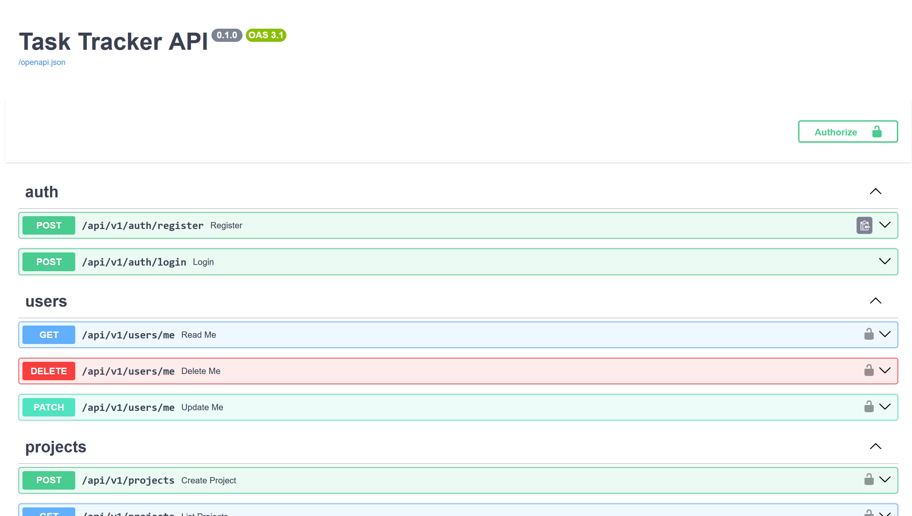
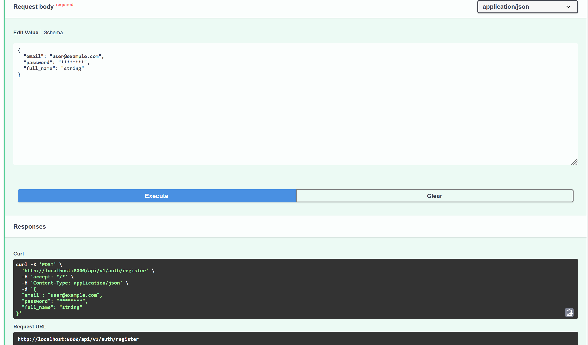

<div align="center">


<a href="https://github.com/MariaLysiukq/Task-Tracker-API">
  
</a>

[](https://github.com/MariaLysiukq/Task-Tracker-API/actions/workflows/ci.yml)


</div>

A REST API for team task tracking. Users create projects, invite members, assign tasks
with status, priority and due dates, and discuss them in comments. Every nested
resource is permission-checked, so teams never see each other's data.

<!-- Screenshot: Swagger UI overview (save as docs/screenshots/swagger.png) -->
<p align="center">
  
</p>

## Contents

- [Features](#features)
- [Tech stack](#tech-stack)
- [Getting started](#getting-started)
- [Usage](#usage)
- [API overview](#api-overview)
- [Testing and quality](#testing-and-quality)
- [Project structure](#project-structure)
- [Known limitations](#known-limitations)
- [Contributing](#contributing)
- [License](#license)
- [Authors and acknowledgements](#authors-and-acknowledgements)

## Features

- Registration, login (JWT bearer token) and personal profile
- Projects with an `owner` and `member` roles; only the owner edits, deletes and manages members
- Tasks with `status` (todo / in_progress / done), `priority` (low / medium / high), assignee and `due_at`
- Filters by `status`, `priority`, `assignee_id` and `overdue`; sorting by `created_at` or `id`
- Pagination on every list: `limit` (1-100, default 20) and `offset`
- Comments editable and deletable only by their author
- Cascading deletes; removed members' tasks stay with `assignee_id = null`
- Passwords stored as Argon2 hashes; all timestamps are timezone-aware UTC

## Tech stack

| Layer      | Tools                                                  |
|------------|--------------------------------------------------------|
| Web        | FastAPI, Pydantic v2, Uvicorn                          |
| Database   | PostgreSQL (Neon), SQLAlchemy 2.0 async, asyncpg       |
| Migrations | Alembic                                                |
| Security   | PyJWT, pwdlib (Argon2)                                 |
| Quality    | pytest, Ruff, mypy --strict, Gitleaks, pre-commit      |
| Delivery   | Docker, Docker Compose, GitHub Actions                 |

## Getting started

### Prerequisites

- Python 3.12
- A PostgreSQL database
- Docker (optional, for containers and the local test database)
- `curl` and [`jq`](https://jqlang.org) for the usage example

### Installation

```bash
git clone https://github.com/MariaLysiukq/Task-Tracker-API.git
cd Task-Tracker-API
python -m venv .venv
source .venv/bin/activate        # Windows: .venv\Scripts\activate
pip install -r requirements-dev.txt
```

### Configuration

Copy the template and fill in your own values.

```bash
cp .env.example .env
```

| Variable             | Description                                       | Default |
|----------------------|---------------------------------------------------|---------|
| `DATABASE_URL`       | Async URL, `postgresql+asyncpg://...?ssl=require` | -       |
| `JWT_SECRET`         | Secret key used to sign tokens                    | -       |
| `JWT_ALGORITHM`      | Token signing algorithm                           | `HS256` |
| `JWT_EXPIRE_MINUTES` | Token lifetime in minutes                         | `30`    |
| `TEST_DATABASE_URL`  | Separate database for tests (optional)            | SQLite in memory |

### Run locally

```bash
alembic upgrade head
uvicorn app.main:app --reload
```

### Run with Docker

```bash
docker compose up --build
```

The container applies migrations on start. The API is available at
<http://localhost:8000>, interactive docs at <http://localhost:8000/docs>.

## Usage

The main scenario with `curl`, runnable as is against a fresh database: the owner
creates a project and adds a member, the member creates a task and a comment and
changes the status, then the owner removes the member.

```bash
API=http://localhost:8000/api/v1
JSON="Content-Type: application/json"

# 1. Register the owner and the member, log both in
curl -s -X POST $API/auth/register -H "$JSON" \
  -d '{"email": "owner@example.com", "password": "ownerpass1", "full_name": "Olena"}'
MEMBER_ID=$(curl -s -X POST $API/auth/register -H "$JSON" \
  -d '{"email": "member@example.com", "password": "memberpass1", "full_name": "Bohdan"}' | jq .id)
OWNER=$(curl -s -X POST $API/auth/login -H "$JSON" \
  -d '{"email": "owner@example.com", "password": "ownerpass1"}' | jq -r .access_token)
MEMBER=$(curl -s -X POST $API/auth/login -H "$JSON" \
  -d '{"email": "member@example.com", "password": "memberpass1"}' | jq -r .access_token)

# 2. Owner creates a project and adds the member
PROJECT_ID=$(curl -s -X POST $API/projects -H "Authorization: Bearer $OWNER" -H "$JSON" \
  -d '{"name": "Website relaunch"}' | jq .id)
curl -s -X POST $API/projects/$PROJECT_ID/members -H "Authorization: Bearer $OWNER" -H "$JSON" \
  -d "{\"user_id\": $MEMBER_ID}"

# 3. Member creates a task assigned to themselves and comments on it
TASK_ID=$(curl -s -X POST $API/projects/$PROJECT_ID/tasks -H "Authorization: Bearer $MEMBER" -H "$JSON" \
  -d "{\"title\": \"Draft homepage\", \"priority\": \"high\", \"assignee_id\": $MEMBER_ID, \"due_at\": \"2030-01-01T12:00:00+02:00\"}" | jq .id)
curl -s -X POST $API/tasks/$TASK_ID/comments -H "Authorization: Bearer $MEMBER" -H "$JSON" \
  -d '{"body": "Started on the layout"}'

# 4. Member moves the task to in_progress
curl -s -X PATCH $API/tasks/$TASK_ID -H "Authorization: Bearer $MEMBER" -H "$JSON" \
  -d '{"status": "in_progress"}'

# 5. Owner removes the member: the task stays unassigned, the member loses access
curl -s -o /dev/null -w "%{http_code}\n" -X DELETE \
  $API/projects/$PROJECT_ID/members/$MEMBER_ID -H "Authorization: Bearer $OWNER"   # 204
curl -s $API/tasks/$TASK_ID -H "Authorization: Bearer $OWNER" | jq .assignee_id     # null
curl -s -o /dev/null -w "%{http_code}\n" \
  $API/tasks/$TASK_ID -H "Authorization: Bearer $MEMBER"                            # 404
```

<!-- Screenshot: a request and response in Swagger UI (save as docs/screenshots/request.png) -->
<p align="center">
  
</p>

## API overview

All routes use the `/api/v1` prefix and, except registration and login, require
`Authorization: Bearer <token>`.

<details>
<summary><b>Endpoints</b></summary>

| Method                | Path                                  | Access          |
|-----------------------|---------------------------------------|-----------------|
| POST                  | `/auth/register`                      | Public          |
| POST                  | `/auth/login`                         | Public          |
| GET / PATCH / DELETE  | `/users/me`                           | Self            |
| POST / GET            | `/projects`                           | Any user / members |
| GET                   | `/projects/{id}`                      | Members         |
| PATCH / DELETE        | `/projects/{id}`                      | Owner           |
| GET                   | `/projects/{id}/members`              | Members         |
| POST                  | `/projects/{id}/members`              | Owner           |
| DELETE                | `/projects/{id}/members/{user_id}`    | Owner           |
| POST / GET            | `/projects/{id}/tasks`                | Members         |
| GET / PATCH / DELETE  | `/tasks/{id}`                         | Members         |
| POST / GET            | `/tasks/{id}/comments`                | Members         |
| PATCH / DELETE        | `/comments/{id}`                      | Author (member) |

</details>

<details>
<summary><b>Status codes</b></summary>

| Code | Meaning                                                          |
|------|------------------------------------------------------------------|
| 201  | Resource created                                                 |
| 200  | Read or update succeeded                                         |
| 204  | Resource deleted                                                 |
| 401  | Missing or invalid token                                         |
| 403  | Authenticated, but not allowed (for example a member editing a project) |
| 404  | Not found, or not visible to you                                 |
| 409  | Conflict (duplicate email or member, owner deleting account with projects) |
| 422  | Invalid input                                                    |

</details>

## Testing and quality

Tests use in-memory SQLite by default and never touch the main database.
To run them against PostgreSQL, start the local test container:

```bash
docker compose --profile test up -d test-db
pytest --cov                     # uses TEST_DATABASE_URL if set
pre-commit install               # run the hooks on every commit
pre-commit run --all-files       # Ruff, mypy --strict, Gitleaks, empty-line check
```
CI runs the same hooks, the test suite (coverage gate 80%) and a Docker build on every push.

## Project structure

```text
app/
├── api/v1/         # Routers (HTTP layer)
├── services/       # Business rules
├── repositories/   # Database queries
├── models/         # SQLAlchemy models
├── schemas/        # Pydantic schemas
├── core/           # Config, database, security, errors
└── _detail/        # Constants and helpers
alembic/            # Migrations
scripts/            # Custom pre-commit hooks
tests/
├── unit/
└── integration/
```

## Known limitations

- Access tokens stay valid until they expire; changing the password or deleting the account
  does not revoke them early (a deleted user's token gets 401). There is no logout or refresh token.
- Project ownership cannot be transferred; the owner can leave only by deleting the project.
- Deleting an account also deletes the comments its user wrote.
- The task list cannot filter for unassigned tasks (`assignee_id` accepts only a user id).
- No rate limiting on login.

## Contributing

1. Create a branch from `main`.
2. Make the change and add tests.
3. Make sure `pre-commit run --all-files` and `pytest` pass.
4. Open a pull request with a short description of the change.

Bug reports and ideas are welcome in [Issues](https://github.com/MariaLysiukq/Task-Tracker-API/issues).

## License

Released under the [MIT License](LICENSE).

## Authors and acknowledgements

- **Maria Lysiuk** - [@MariaLysiukq](https://github.com/MariaLysiukq)

Built as the final project of the Python Backend course. AI assistance during
development is documented in [`docs/ai-log.md`](docs/ai-log.md).


